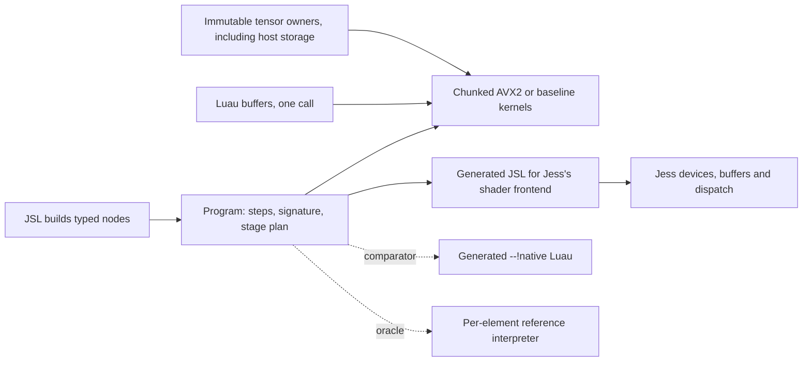

# Compute architecture: decision and evidence

## Decision

**Execute a small typed plan over ahead-of-time SIMD kernels, one dispatch per operation per
1,024-element chunk. Generate no machine code. Reject CubeCL.**

The first prototype's problem was granularity, not the absence of a compiler. It dispatched six
instructions for each output element, which cost 10 ns per element and kept the compiler from
vectorizing anything. Moving dispatch up to one per 1,024 elements gets within 1.4x of a handwritten
AVX2 loop at 65,536 elements, using fixed Rust loops with no run-time code generation, no new
dependency and almost no `unsafe`.

## Performance

Intel i7-10870H (8 cores, 32 KiB L1d, 256 KiB L2 per core, AVX2, no AVX-512), Linux 7.2, rustc 1.99.1
(LLVM 23.1.1), Clang 23.1.2, release with cross-language LTO. Three fresh processes, each row 31
samples of at least 3 ms from Rust or 2 ms from JSL. A value is the middle of the three process medians;
across those processes the medians moved by up to about 10%, more in rows marked below. Other work
was running on the machine (load average 3 to 8 of 16 threads). Raw reports with min and p90 are
in `results/compute-{1,2,3}.txt`.

### `relu(a+b+2)`: one contract, preallocated output, microseconds

| n | Handwritten fused AVX2 | Chunked | Ratio | Per-element reference | Speedup over reference |
| ---: | ---: | ---: | ---: | ---: | ---: |
| 0 | 0.002 | 0.075 | fixed cost | 0.018 | slower |
| 1 | 0.003 | 0.099 | fixed cost | 0.028 | slower |
| 16 | 0.005 | 0.113 | fixed cost | 0.173 | 1.5x |
| 1,024 | 0.062 | 0.241 | **3.9x** | 10.58 | 44x |
| 65,536 | 12.4 | 17.6 | **1.4x** | 682 | 39x |
| 1,048,576 | 253 | 333 | **1.3x** | 11,193 | 34x |

The 2-3x stretch target holds at 65,536 and 1,048,576 and **is missed at 1,024**, where everything
stays in L1 and the fused loop's single pass has no memory bottleneck to share with the kernels' three.
Sizes in between were not measured. There the gap is 0.18 us, less than one call from JSL costs
(next table, n=0).

### `relu(a+b+2)` from JSL, end to end, microseconds

Allocation and storage contracts differ by column and are stated.

| n | `runInto`: borrowed buffers, preallocated | `run`: fresh native result | `dream.data` 3 passes, preallocated | Generated Luau JIT, strict, preallocated | Handwritten Luau JIT, f64, preallocated | Handwritten, interpreter | Reference, fresh result |
| ---: | ---: | ---: | ---: | ---: | ---: | ---: | ---: |
| 0 | 0.23 | 0.39 | 0.24 | 0.07 | 0.03 | 0.04 | 0.33 |
| 1 | 0.28 | 0.49 | 0.27 | 0.08 | 0.04 | 0.06 | 0.38 |
| 16 | 0.27 | 0.48 | 0.38 | 0.21 | 0.11 | 0.49 | 0.55 |
| 1,024 | 0.45 | 0.94 | 6.3 | 8.2 | 7.0 | 28 | 12.0 |
| 65,536 | 18.9 | 35.6 (p90 up to 74: GC) | 392 | 566 | 458 | 1,678 | 736 |
| 1,048,576 | 358 | 601 (p90 up to 1,588: GC) | 6,705 | | | | |

Luau is faster at 16 elements and below, where the call dominates. The handoff's 16.4 us Rust loop was
the default-target (SSE2) loop; this report compares like with like on AVX2 and shows both.

### Costs other than the kernel, from JSL at n=65,536

| Phase | Time | Notes |
| --- | ---: | --- |
| Build the graph | 5 to 7 us | Three typed nodes plus slots. Under 1 us in Rust. |
| Validate and plan | 5 to 7 us | Under 1 us in Rust. **No code is generated.** |
| Load and JIT the generated Luau | 270 to 390 us | The `program:native()` comparator; per program, per VM. |
| Bind inputs | at most 0.08 us | Bounded by the whole fixed cost in Rust at n=0. Zero copies. |
| Import two inputs as tensors | 40 to 90 us | One explicit copy each; only needed to retain them. |
| Result allocation | ~5 us | Rust: 22.2 fresh vs 17.6 preallocated. |
| Readback to a new Luau buffer | 26 us | One explicit copy. |
| First `runInto` | 22 to 80 us | Fresh pages. Warm: 19 us. |

Rust heap per library call, not counting Luau's wrapper objects: `run_into` 1 allocation of 128 bytes
(the bound sources), `run` 4 allocations including the result. 64 independent programs: 64 us to compile in total, then 16 us to run all of
them over 1,024 elements each. Peak budget in the JSL bench reached its 64 MiB limit by design: unreferenced
results accumulate until the budget forces a collection. Whole-process peak RSS was 94 to 98 MiB
for the complete bench, including all fixtures at n=1,048,576.

### Strided and broadcast inputs (preallocated, n=65,536)

| Input | Chunked | Reference | Speedup |
| --- | ---: | ---: | ---: |
| Contiguous | 17.6 | 682 | 39x |
| Padded (stride 8) | 57 | 705 | 12x |
| Transposed square | 87 | 738 | 8.5x |
| Column broadcast, 256 columns | 18.5 | 672 | 36x |
| Column broadcast, 2 columns | 68 | 736 | 11x |

Gathering is a separate loop, per chunk, so a strided input costs its walk and nothing else.

### Matrix multiplication (square, us; "scalar ops" counts multiply-adds; reference allocates, the rest are preallocated)

| Side | Scalar ops | Chunked AVX2 | Chunked baseline | Reference | Speedup | Handwritten Luau JIT |
| ---: | ---: | ---: | ---: | ---: | ---: | ---: |
| 16 | 4,096 | 0.51 | 0.57 | 8.4 | 16x | 18 |
| 64 | 262,144 | 13.4 | 21 | 415 | 31x | 1,069 |
| 128 | 2,097,152 | 94 | 155 | 3,298 | 35x | |
| 256 | 16,777,216 | 796 | 1,207 | 37,811 | 47x | 68,781 |
| 400 | 64,000,000 | 2,668 | 4,634 | 102,681 | 38x | |

About 24 multiply-adds per nanosecond at the top end (0.042 ns each), single-threaded and strictly
ordered. Results are bit-identical to the reference on every row, asserted during the bench.

## The questions

**1. Why was the executor so much slower than a native loop?** Per-element dynamic dispatch through a
checked, strided read: 10.3 ns per element against 0.2.

**2. How much does each cost?** The ladder, for `relu(a+b+2)` at n=65,536, is below. Costs are not
additive, because the first thing dispatch or a checked read destroys is vectorization.

| Step, each measured on its own | us | ns/element |
| --- | ---: | ---: |
| Fused loop over `f32` slices, AVX2 | 13.8 | 0.21 |
| Fused, over `[u8; 4]` little-endian elements, AVX2 (**byte conversion: no cost**) | 13.9 | 0.21 |
| Fused, default target (SSE2) | 16.0 | 0.24 |
| Three monomorphic passes, AVX2 (**no fusion, cache traffic: 1.7x**) | 23.5 | 0.36 |
| Chunked kernels, AVX2 | 17.7 | 0.27 |
| Fused, through the checked strided read, no dispatch (**indexing: 5.6x**) | 78 | 1.18 |
| Per-element dispatch over direct slices, no checked read (**dispatch: 30x**) | 411 | 6.3 |
| Reference: dispatch and checked read | 679 | 10.4 |
| Reference with result allocation (**allocation: lost in the noise**) | 673 | 10.3 |

Three more passes through `dream.data` take 392 us, against 23.5 for the same three passes written
monomorphically. The difference is a per-element match on the element kind and an f64 round trip,
not the number of passes.

**3. Can L3i's native lowering execute tensor operations?** Not usefully. Luau's IR has scalar buffer
loads with a bounds check per access (`results/luau-relu-sum-ir-and-x64.txt`), no vector loads from a
buffer, and no way to read external storage. Reusing the host hooks would still mean a scalar loop per
element, and each program costs about 300 us to load and JIT per VM.

**4. Can Luau's JIT optimize structured numerical loops?** Yes, as scalar code. Native execution is about 4x
the interpreter's speed, and 7 ns per element is good for what it does. It remains 24x slower than the
kernels at 65,536 because it does not vectorize. It stays the right tool for irregular per-element
logic that bulk kernels cannot express. All of this requires a sandboxed VM: without one, the same
loop measures 110 ns per element.

**5. Is a small compute IR justified?** Yes, a very small one. The plan is about 220 lines of planner
and six instruction kinds. An eager API cannot supply what it provides: signature checks, register
reuse, and one description for CPU and GPU. Anything larger is not justified by these numbers.

**6. Is fusion necessary, and at what level?** Chunk-level fusion is worth having but is not the main
effect. It saves about 25% against whole-array passes at 65,536 (17.7 vs 23.5) and removes
array-sized temporaries. Element-level fusion, the only thing generated code could add, would buy at
most 1.3 to 1.4x on arrays beyond L1. A 16-operation chain measured the same: 55 us chunked, 41 us
fused. It would buy up to 3.9x inside L1, which is at most 0.18 us per call at n=1,024. That does not
justify per-architecture code generators, executable memory and a code budget.

**7. Should elementwise work use `dream.data`?** Its explicit calls should stay: they are eager, cover eight
element kinds and define ordered overlap, which this design rejects. But they could be far faster
under the same contract. Monomorphizing the contiguous `f32` loops, with an overlap check to keep the
ordered semantics, has about 16x available (392 to at best 23.5). That is a separate production change
and has not been made here.

**8. Which ownership abstractions are reusable?** `Storage` + `Tensor` + `View` (immutable owners,
checked views), `Budget` and `Domain` (host-owned accounting). They carried over with minimal change,
and removing captured inputs made them simpler. `View` is the one thing kernels read.

**9. Would CubeCL provide something unavailable?** No. See below.

**10. Compiler, scheduling, or both?** Neither, so far: it was an execution-granularity problem and a
kernel-quality problem. Scheduling arrives with multi-threading, and that belongs to Jess.

## CubeCL verdict: rejected

| | CubeCL 0.10 CPU, earlier release runs | This design |
| --- | ---: | ---: |
| `relu(a+b+2)`, n=1,024, first call | 26,000 us (kernel compile, init, transfers) | 4 us (first `runInto`, no compile) |
| n=1,024, warm | 490 to 530 us | 0.45 us preallocated; 0.94 us fresh output |
| n=65,536, warm | 920 to 1,100 us | 19 us preallocated; 36 us fresh output |
| Dependencies | Bundled LLVM (20 for 0.10, 23 for 0.11), worker pool, alpha compiler APIs | L3i only |
| Failure and time limits | No hard LLVM time or memory limit; needs process isolation for hostile input | Bounded at compile time; no compiler to contain |

The contracts are not equal: CubeCL's numbers include input copies, dispatch, synchronization and
readback, which is its bridge's actual path, and the runs come from an earlier point on the branch. The
gap (26x on the fairest row) is too large for those differences to close. Its GPU story duplicates Jess's
device, buffer and scheduling ownership, and strict f32 was never established on its targets. Its IR is
a capable general compiler, and the numbers do not call for one. `9e70c0f` retains the experiments if a
future workload (real tensor kernels on GPU, say) changes this.

## Correctness

This revision passes debug and release tests. Beyond the targeted tests for each contract in the crate
README:

- **Randomized oracles.** 400 random DAGs over random shapes, broadcasts and layouts (any offset, stride
  zero through overlapping through padded) compare the chunked kernels on both instantiations and four
  chunk sizes against an independent scalar evaluator and the reference, bitwise. 120 random matrix
  products do the same against an independent ordered triple loop.
- **Injected bugs.** `results/mutations.txt`: fifteen deliberate defects are all caught, and a comment-only
  control survives. The first round found three **survivors**, reversed matmul addition order, FMA in
  matmul, and folded `relu(-0)`, because NaN and wild exponents hid rounding. Half the random cases now
  use same-magnitude values on purpose. (That round's driver also counted "0 failed" as a catch; it was
  fixed and rerun.)
- **Generated shader.** `jess run generated-shader.jsl` passes against reference results across three input
  sets, on Jess's existing device, buffers, pipeline and readback. Only the `integer-exact` mode exists;
  `strict` is rejected. GPU throughput has not been benchmarked: this proves lowering and resource reuse.

Teardown: the JSL test runs twice with fresh VMs; everything must return to zero live payload after
collection, and a retained program survives collection and runs on new inputs.

## Not done

- **Multi-threading.** Every number here is one thread. Chunks are independent given their position, so
  a scheduler hook is the natural seam, and it belongs to Jess.
- **A wider operation set and general rank.** Inference needs more: at minimum subtract, divide, min,
  max, exp, reductions, a softmax's worth of ordering rules, and rank above two. Each new elementwise
  operation is a kernel and a numerical contract, not a compiler change.
- **A strict GPU mode**, and any GPU throughput measurement on real hardware.
- **Jess integration**: a `Storage` adapter for `SharedBuffer`, generation-owned programs, and budgets
  from Jess's resource policy. The shader lowering emits JSL source; a production path would lower to
  Jess's typed shader program in-process.
- **A public `Call::collect_garbage`** in L3i, needed before this leaves research.
- **`dream.data` monomorphization** (question 7).
- **Scalar reads of shared immutable buffers from Luau.** Direct, guarded reads of external storage from
  generated Luau remain unexplored. Bulk kernels make it matter less for numerical work; it is still open for scalar code.
- **aarch64 and AVX-512 measurements.** The baseline instantiation compiles for aarch64 but has not been
  run there, and this hardware has no AVX-512.
- **The MSRV.** `d2a7a19` raised it to 1.99.1 alongside the CubeCL experiments, which needed at least 1.95.
  This work leaves it unchanged. With CubeCL rejected, whether L3i keeps 1.99.1 is worth a separate decision.
