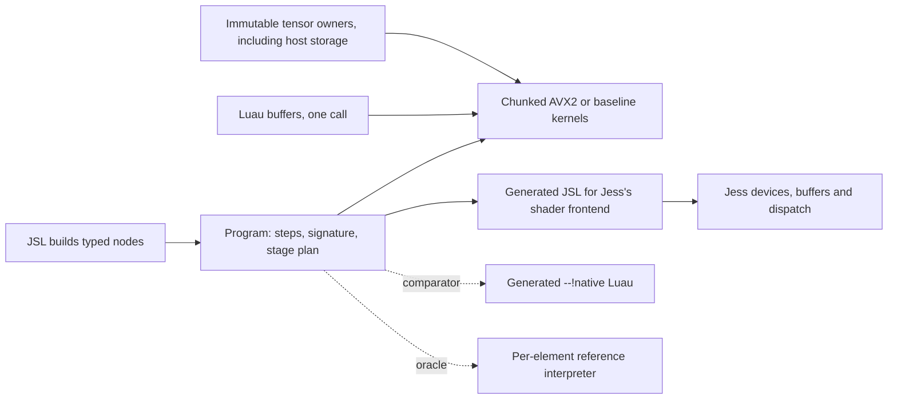

# Compute architecture: decision and evidence

## Decision

**A CPU-only engine for x86-64 and AArch64: a small typed plan over precompiled SIMD kernels, growing by kernel family, with no
executable memory required. Do not adopt CubeCL. Do not build a JIT now: on a transformer-style pass matmul is about 90% of the work
and elementwise chains about 1%, and a generated loop gains at most about 1.35x in cycles on the elementwise work it can touch. See
"Direction" below.**

The first prototype's problem was granularity, not the absence of a compiler. It dispatched six
instructions for each output element, which cost 10 ns per element and kept the compiler from
vectorizing anything. Moving dispatch up to one per 1,024 elements gets within 1.4x of a handwritten
AVX2 loop at 65,536 elements, using fixed Rust loops with no run-time code generation, no new
dependency and almost no `unsafe`.

## Performance

The timing tables in this section predate tiled kernels and the matmul microkernel; they describe the first chunked
revision and are kept as the record of how the interpreter was replaced. Current comparisons are in instructions, in
the CubeCL section.

Intel i7-10870H (8 cores, 32 KiB L1d, 256 KiB L2 per core, AVX2, no AVX-512), Linux 7.2, rustc 1.99.1
(LLVM 23.1.1), Clang 23.1.2, release with cross-language LTO. Three fresh processes, each row 31
samples of at least 3 ms from Rust or 2 ms from JSL. A value is the middle of the three process medians;
across those processes the medians moved by up to about 10%, more in rows marked below. Other work
was running on the machine (load average 3 to 8 of 16 threads). Raw reports with min and p90 are
in `results/compute-{1,2,3}.txt`.

### `relu(a+b+2)`: one contract, preallocated output, microseconds

| n | Handwritten fused AVX2 | Chunked | Ratio | Per-element reference | Speedup over reference |
| ---: | ---: | ---: | ---: | ---: | ---: |
| 0 | 0.002 | 0.075 | fixed cost | 0.018 | slower |
| 1 | 0.003 | 0.099 | fixed cost | 0.028 | slower |
| 16 | 0.005 | 0.113 | fixed cost | 0.173 | 1.5x |
| 1,024 | 0.062 | 0.241 | **3.9x** | 10.58 | 44x |
| 65,536 | 12.4 | 17.6 | **1.4x** | 682 | 39x |
| 1,048,576 | 253 | 333 | **1.3x** | 11,193 | 34x |

The 2-3x stretch target holds at 65,536 and 1,048,576 and **is missed at 1,024**, where everything
stays in L1 and the fused loop's single pass has no memory bottleneck to share with the kernels' three.
Sizes in between were not measured. There the gap is 0.18 us, less than one call from JSL costs
(next table, n=0).

### `relu(a+b+2)` from JSL, end to end, microseconds

Allocation and storage contracts differ by column and are stated.

| n | `runInto`: borrowed buffers, preallocated | `run`: fresh native result | `dream.data` 3 passes, preallocated | Generated Luau JIT, strict, preallocated | Handwritten Luau JIT, f64, preallocated | Handwritten, interpreter | Reference, fresh result |
| ---: | ---: | ---: | ---: | ---: | ---: | ---: | ---: |
| 0 | 0.23 | 0.39 | 0.24 | 0.07 | 0.03 | 0.04 | 0.33 |
| 1 | 0.28 | 0.49 | 0.27 | 0.08 | 0.04 | 0.06 | 0.38 |
| 16 | 0.27 | 0.48 | 0.38 | 0.21 | 0.11 | 0.49 | 0.55 |
| 1,024 | 0.45 | 0.94 | 6.3 | 8.2 | 7.0 | 28 | 12.0 |
| 65,536 | 18.9 | 35.6 (p90 up to 74: GC) | 392 | 566 | 458 | 1,678 | 736 |
| 1,048,576 | 358 | 601 (p90 up to 1,588: GC) | 6,705 | | | | |

Luau is faster at 16 elements and below, where the call dominates. The handoff's 16.4 us Rust loop was
the default-target (SSE2) loop; this report compares like with like on AVX2 and shows both.

### Costs other than the kernel, from JSL at n=65,536

| Phase | Time | Notes |
| --- | ---: | --- |
| Build the graph | 5 to 7 us | Three typed nodes plus slots. Under 1 us in Rust. |
| Validate and plan | 5 to 7 us | Under 1 us in Rust. **No code is generated.** |
| Load and JIT the generated Luau | 270 to 390 us | The `program:native()` comparator; per program, per VM. |
| Bind inputs | at most 0.08 us | Bounded by the whole fixed cost in Rust at n=0. Zero copies. |
| Import two inputs as tensors | 40 to 90 us | One explicit copy each; only needed to retain them. |
| Result allocation | ~5 us | Rust: 22.2 fresh vs 17.6 preallocated. |
| Readback to a new Luau buffer | 26 us | One explicit copy. |
| First `runInto` | 22 to 80 us | Fresh pages. Warm: 19 us. |

Rust heap per library call, not counting Luau's wrapper objects: `run_into` 1 allocation of 128 bytes
(the bound sources), `run` 4 allocations including the result. 64 independent programs: 64 us to compile in total, then 16 us to run all of
them over 1,024 elements each. Peak budget in the JSL bench reached its 64 MiB limit by design: unreferenced
results accumulate until the budget forces a collection. Whole-process peak RSS was 94 to 98 MiB
for the complete bench, including all fixtures at n=1,048,576.

### Strided and broadcast inputs (preallocated, n=65,536)

| Input | Chunked | Reference | Speedup |
| --- | ---: | ---: | ---: |
| Contiguous | 17.6 | 682 | 39x |
| Padded (stride 8) | 57 | 705 | 12x |
| Transposed square | 87 | 738 | 8.5x |
| Column broadcast, 256 columns | 18.5 | 672 | 36x |
| Column broadcast, 2 columns | 68 | 736 | 11x |

Gathering is a separate loop, per chunk, so a strided input costs its walk and nothing else.

### Matrix multiplication (square, us; "scalar ops" counts multiply-adds; reference allocates, the rest are preallocated)

| Side | Scalar ops | Chunked AVX2 | Chunked baseline | Reference | Speedup | Handwritten Luau JIT |
| ---: | ---: | ---: | ---: | ---: | ---: | ---: |
| 16 | 4,096 | 0.51 | 0.57 | 8.4 | 16x | 18 |
| 64 | 262,144 | 13.4 | 21 | 415 | 31x | 1,069 |
| 128 | 2,097,152 | 94 | 155 | 3,298 | 35x | |
| 256 | 16,777,216 | 796 | 1,207 | 37,811 | 47x | 68,781 |
| 400 | 64,000,000 | 2,668 | 4,634 | 102,681 | 38x | |

About 24 multiply-adds per nanosecond at the top end (0.042 ns each), single-threaded and strictly
ordered. Results are bit-identical to the reference on every row, asserted during the bench.

## The questions

**1. Why was the executor so much slower than a native loop?** Per-element dynamic dispatch through a
checked, strided read: 10.3 ns per element against 0.2.

**2. How much does each cost?** The ladder, for `relu(a+b+2)` at n=65,536, is below. Costs are not
additive, because the first thing dispatch or a checked read destroys is vectorization.

| Step, each measured on its own | us | ns/element |
| --- | ---: | ---: |
| Fused loop over `f32` slices, AVX2 | 13.8 | 0.21 |
| Fused, over `[u8; 4]` little-endian elements, AVX2 (**byte conversion: no cost**) | 13.9 | 0.21 |
| Fused, default target (SSE2) | 16.0 | 0.24 |
| Three monomorphic passes, AVX2 (**no fusion, cache traffic: 1.7x**) | 23.5 | 0.36 |
| Chunked kernels, AVX2 | 17.7 | 0.27 |
| Fused, through the checked strided read, no dispatch (**indexing: 5.6x**) | 78 | 1.18 |
| Per-element dispatch over direct slices, no checked read (**dispatch: 30x**) | 411 | 6.3 |
| Reference: dispatch and checked read | 679 | 10.4 |
| Reference with result allocation (**allocation: lost in the noise**) | 673 | 10.3 |

Three more passes through `dream.data` take 392 us, against 23.5 for the same three passes written
monomorphically. The difference is a per-element match on the element kind and an f64 round trip,
not the number of passes.

**3. Can L3i's native lowering execute tensor operations?** Not usefully. Luau's IR has scalar buffer
loads with a bounds check per access (`results/luau-relu-sum-ir-and-x64.txt`), no vector loads from a
buffer, and no way to read external storage. Reusing the host hooks would still mean a scalar loop per
element, and each program costs about 300 us to load and JIT per VM.

**4. Can Luau's JIT optimize structured numerical loops?** Yes, as scalar code. Native execution is about 4x
the interpreter's speed, and 7 ns per element is good for what it does. It remains 24x slower than the
kernels at 65,536 because it does not vectorize. It stays the right tool for irregular per-element
logic that bulk kernels cannot express. All of this requires a sandboxed VM: without one, the same
loop measures 110 ns per element.

**5. Is a small compute IR justified?** Yes, a very small one. The plan is about 220 lines of planner
and six instruction kinds. An eager API cannot supply what it provides: signature checks, register
reuse, and one description for CPU and GPU. Anything larger is not justified by these numbers.

**6. Is fusion necessary, and at what level?** Chunk-level fusion is worth having but is not the main
effect. It saves about 25% against whole-array passes at 65,536 (17.7 vs 23.5) and removes
array-sized temporaries. Element-level fusion, the only thing generated code could add, buys about 1.4x on a short expression beyond L1,
and about 1.5 to 2.6x on a 16-operation chain beyond L1 (see the CubeCL section; an earlier version of this answer
said 1.4x and was too low). Inside L1 it buys up to 3.9x, at most 0.18 us per call at n=1,024. Whether that justifies
per-architecture code generators, executable memory and a code budget is open. A cheaper candidate to measure first
is a set of fused kernels for common shapes such as `relu(a*b+c)`, which remove stores without generating code.

**7. Should elementwise work use `dream.data`?** Its explicit calls should stay: they are eager, cover eight
element kinds and define ordered overlap, which this design rejects. But they could be far faster
under the same contract. Monomorphizing the contiguous `f32` loops, with an overlap check to keep the
ordered semantics, has about 16x available (392 to at best 23.5). That is a separate production change
and has not been made here.

**8. Which ownership abstractions are reusable?** `Storage` + `Tensor` + `View` (immutable owners,
checked views), `Budget` and `Domain` (host-owned accounting). They carried over with minimal change,
and removing captured inputs made them simpler. `View` is the one thing kernels read.

**9. Would CubeCL provide something unavailable?** On CPU, faster long expressions over large arrays, but fused
kernels or generated code of our own could offer the same. GPU and CubeK are unmeasured. See below.

**10. Compiler, scheduling, or both?** First an execution-granularity problem, which took most of the gain. What
remains on long expressions is a fusion problem, so partly a compiler one. Scheduling arrives with multi-threading,
and that belongs to Jess.

## Direction: a CPU-only engine, with JIT optional and never required

Decided after the experiments below. L3i's numerical backend targets **x86-64 and AArch64 CPUs**, with GPU computation left to
Jess. Every program must run with no executable memory, because consoles and other restricted platforms forbid it, and
Luau's own native code is optional for the same reason. Precompiled kernels are the engine; anything generated at run time
is an optional tier that must first earn its place.

**The no-JIT configuration is now the default and is tested.** `luau-jit` is an opt-in feature used only by the generated-Luau
comparator. Without it, the JSL test also asserts that no anonymous executable memory is mapped. AArch64 has not been compiled, run or
measured for this crate, and a dedicated NEON backend does not exist yet.

### Counters, not clocks

`cubecl-compare` counts retired instructions, cycles, L1 data misses and last-level misses in a disposable container, with no wall
clock anywhere. Cycles expose the memory stalls instructions cannot, but they are sensitive to load: these runs had a load average
up to 17 from other work, so cycle figures are the best of three passes and differences under about 1.2x are noise. Instruction
counts repeat almost exactly. Cycles sum all threads, so CubeCL's include its threads' waiting and should not be read as its speed.

### What a JIT could buy: the ceiling

`cubecl-compare/src/jit.rs` is a research-only generator: any elementwise program from the validated plan becomes one AVX2 loop. It
is under 400 lines including a small VEX encoder, compiles in 7,000 to 29,000 instructions into 72 to 168 bytes, and matched the reference
bitwise on all 393 random graphs it accepted (it refused 7 that needed more than sixteen registers). It is not on any production path.

One thread, strict, tiles against one generated loop. Thousands of instructions, then thousands of cycles.

| Workload | n | Tiles, instructions | Generated, instructions | Tiles, cycles | Generated, cycles |
| --- | ---: | ---: | ---: | ---: | ---: |
| `relu(a+b+2)` | 65,536 | 65 | 74 | 65 | 64 |
| | 1,048,576 | 1,013 | 1,180 | 1,273 | 1,240 |
| 16-operation chain | 65,536 | 360 | 221 | 152 | 197 |
| | 1,048,576 | 5,718 | 3,539 | 2,891 | 3,379 |
| Polynomial | 65,536 | 302 | 172 | 158 | 139 |
| | 1,048,576 | 4,793 | 2,753 | 3,109 | 2,496 |
| Residual DAG | 65,536 | 203 | 131 | 110 | 88 |
| | 1,048,576 | 3,214 | 2,097 | 2,191 | 1,616 |

**A generated loop retires up to 1.7x fewer instructions but takes at most about 1.35x fewer cycles, and on the 16-operation chain
takes more.** Tiles have LLVM's unrolling and scheduling, and the prototype emits one unoptimized vector per iteration, so this
understates what a mature generator could do. It still sets the scale: the prize is tens of percent on elementwise work.

The compact vector interpreter proposed as a third option is rejected: 66 instructions per element on the chain against 5.5 for
tiles, and about 10x the cycles.

### Where a real workload spends its work

`cubecl-compare/src/model.rs` runs a transformer-style forward pass (64 tokens, width 128, two blocks, one head, synthetic weights)
with layer normalization, scaled dot-product attention, residuals and a feed-forward layer. Operations the plan cannot express yet
are shared native loops, labelled below. Share of the fast mode's median pass:

| Family | Instructions | Cycles |
| --- | ---: | ---: |
| **Matmul** | **94.2%** | **85.0%** |
| Normalization (native) | 2.4% | 6.3% |
| Softmax (native) | 1.3% | 3.8% |
| Elementwise (plan) | 1.1% | 2.9% |
| Transpose (native) | 1.0% | 1.9% |

**Elementwise fusion is about 1% of this workload, so a JIT for elementwise chains could not move it.** It is the wrong problem for
inference, though it still matters for simulation-style work, which should be measured on its own terms. Matmul is the right one.

Against a packed BLAS-style baseline (`matrixmultiply`, FMA) in the same pass, this revision's kernel measures:

| Matmul, total for one pass | Instructions | Best cycles | L1 misses |
| --- | ---: | ---: | ---: |
| Ours, strict | 6,218,000 | 2,593,000 | 264,700 |
| Ours, fast | 4,371,000 | 1,741,000 | 271,500 |
| `matrixmultiply` | 4,153,000 | 1,533,000 | 189,500 |

Two changes got it this close, with strict results still bit-identical to the triple loop: packing `b` per block, and a one-row
register kernel for rows left over from the six-row block, which took the fused pass from 5.36M to 4.37M instructions. The remaining
gap is about 5% in instructions and about 14% in best cycles, with more L1 misses; packing `a` for all row groups, as BLAS does, is
the obvious next step. Strict mode pays for separate rounding and cannot match an FMA kernel.

This is one small synthetic model, on one Intel CPU, with quantization, large weight streaming and KV caches absent. It shows the
split for this shape, not all inference.

### Conclusions

1. **Do not build a JIT now.** The measured ceiling is modest and does not touch the workload that matters most.
2. **Grow kernel families, not combinations.** The three-step tile alphabet stays as it is; the generic combination count should not
   grow with the operation set. New work goes into matmul, then normalization, softmax and reductions, then quantized forms.
3. **Build a real AArch64 backend and test it on real hardware.** Nothing here says anything about ARM yet.

## CubeCL verdict: not adopted; matmul and short work won, long expressions on large arrays not

`cubecl-compare/` runs both engines on the same inputs, in separate processes, inside a disposable container
(`run-in-container.sh`, built on the host, no network, removed on exit). The metric is **retired user-space
instructions across all threads**, from the CPU's counter. Counts on our side repeat to within a few instructions
in 22 million, so unlike the timings they can separate the engines on a shared machine. Raw reports are in
`results/compare-*`.

CubeCL gets its best configuration: `Vector` kernels at 1, 8 and 16 lanes (the table takes its lowest count), the
better per contract of a four-row and a six-row matmul kernel, and the same blocking we use. An earlier revision of
this document called CubeCL 26x slower. That figure compared its old bridge, with copies and a cube size of 256, with
our kernels, not the two engines.

### CubeCL's CPU backend is not strict by default

Its optimizer fuses every `a * b + c` whose product has no other use into an FMA, unconditionally, with no opt-out
(`cubecl-opt`'s `InstCombine`). Its output differs from separately rounded f32 and matches an FMA oracle exactly
(`results/compare-diagnosis.txt`). So there are two contracts to compare. The strict rows give each CubeCL product a
never-taken second use, after which every one matches the strict oracle bitwise, including NaN, signed zero and
subnormal edges. The fast rows compare our explicit `Numeric::Fast` with its default. The never-taken branch might
cost CubeCL a little in the strict rows; we did not inspect its generated code, so the fast rows are the cleaner test.

### Strict against strict, one thread, kernel only (thousands of instructions)

| Workload | n | Ours | CubeCL | Fewer instructions |
| --- | ---: | ---: | ---: | --- |
| `relu(a+b+2)` | 16 | 1.6 | 52.6 | ours, 33x |
| | 1,024 | 2.4 | 49.2 | ours, 20x |
| | 16,384 | 17.2 | 63.0 | ours, 3.7x |
| | 65,536 | 64.7 | 109 | ours, 1.7x |
| | 1,048,576 | 1,013 | 1,001 | tie |
| 16-operation chain | 1,024 | 8.7 | 52.3 | ours, 6x |
| | 16,384 | 92 | 106 | ours, 1.15x |
| | 65,536 | 360 | 281 | **CubeCL, 1.28x** |
| | 1,048,576 | 5,718 | 3,677 | **CubeCL, 1.55x** |
| Degree-8 polynomial | 1,024 | 7.7 | 50.3 | ours, 6.5x |
| | 16,384 | 78 | 92 | ours, 1.18x |
| | 65,536 | 302 | 217 | **CubeCL, 1.39x** |
| | 1,048,576 | 4,793 | 2,777 | **CubeCL, 1.73x** |
| Residual-shaped DAG | 1,024 | 5.3 | 49.4 | ours, 9.4x |
| | 16,384 | 52 | 79 | ours, 1.5x |
| | 65,536 | 203 | 173 | **CubeCL, 1.17x** |
| | 1,048,576 | 3,214 | 2,036 | **CubeCL, 1.58x** |
| Matmul | 240x240 | 5,483 | 7,272 | ours, 1.33x |
| | 384x384 | 22,137 | 29,354 | ours, 1.33x |
| Two-layer network | 240 wide | 11,009 | 17,794 | ours, 1.62x |

### Our fast mode against CubeCL's default, one thread, kernel only (thousands of instructions)

| Workload | n | Ours, `Numeric::Fast` | CubeCL default | Fewer instructions |
| --- | ---: | ---: | ---: | --- |
| 16-operation chain | 16,384 | 82 | 93 | ours, 1.13x |
| | 65,536 | 319 | 226 | **CubeCL, 1.42x** |
| | 1,048,576 | 5,067 | 2,838 | **CubeCL, 1.79x** |
| Degree-8 polynomial | 16,384 | 56 | 73 | ours, 1.29x |
| | 65,536 | 219 | 152 | **CubeCL, 1.44x** |
| | 1,048,576 | 3,469 | 1,694 | **CubeCL, 2.05x** |
| Residual-shaped DAG | 65,536 | 203 | 161 | **CubeCL, 1.26x** |
| | 1,048,576 | 3,214 | 1,813 | **CubeCL, 1.77x** |
| Matmul | 240x240 | 3,753 | 4,418 | ours, 1.18x |
| | 384x384 | 15,056 | 17,674 | ours, 1.17x |
| Two-layer network | 240 wide | 7,550 | 10,765 | ours, 1.43x |

Our fast mode does not fuse the residual DAG: its products are not adjacent to their adds in the plan.

### Eight threads, total work, not speed

These count all threads' instructions including any spinning, so they measure overhead and say nothing about how
soon the work finishes. Our threads are a benchmark-only rayon pool; L3i has no threading of its own.

| Workload | n | Ours | CubeCL strict |
| --- | ---: | ---: | ---: |
| `relu(a+b+2)` | 65,536 | 313 | 360 |
| | 1,048,576 | 1,325 | 1,263 |
| 16-operation chain | 65,536 | 637 | 547 |
| | 1,048,576 | 6,132 | 4,307 |
| Polynomial | 1,048,576 | 5,194 | 2,983 |
| Matmul | 240x240 | 5,845 | 7,565 |
| | 384x384 | 23,025 | 30,403 |

### Compile cost

Building and compiling a graph costs ours 25,000 to 78,000 instructions. A first launch costs CubeCL 17.6 million
on average and up to 148 million, about 225 to 700 times as much, per kernel and width. Its client initialization is
another 0.5 million.

### What this metric cannot see

- **Memory stalls and port pressure.** An instruction that waits on memory counts the same as one that does not, and
  the workloads where CubeCL leads are the ones that exceed cache. Treat large-array ratios as evidence about code,
  not as a promise about wall time.
- **Copies.** `memcpy` retires few instructions per byte, so CubeCL's copy-in and readback rows look nearly free here
  (1.14 million instructions at n=1,048,576, against 1.00 million for the kernel alone). They are not: under the earlier
  timing they cost about 10x.
- **Parallel speedup**, as above.

### What this establishes

We lead on everything small or medium, on every matmul, and on the network. Below about 16,384 elements that is
CubeCL's roughly 50,000-instruction dispatch, a cost of its queue and pool. **On long expressions from somewhere
between 16,384 and 65,536 elements upward, CubeCL still leads, by 1.2x to 2x.** The short expression ties.

That remaining gap is structural. A tile costs a load, a store and loop control per vector, so a 16-operation chain
in six tiles pays those six times, while one generated loop pays them once. More compiled combinations narrow it but
cannot close it: a useful alphabet at three steps is about 2,400 loops per instantiation, with the build time and
binary size that implies, and it would still leave two tiles on the chain. Only generating one loop per expression
removes it, and the ceiling measurement above shows that buys less in cycles than in instructions.

We do not adopt CubeCL because of its compile cost, bundled LLVM, unbounded compile limits, silent FMA and overlap
with Jess's GPU ownership. Not measured: GPU execution, which is CubeCL's main purpose, and CubeK's matmul.

## Correctness

This revision passes debug and release tests. Beyond the targeted tests for each contract in the crate
README:

- **Randomized oracles.** 400 random DAGs over random shapes, broadcasts and layouts (any offset, stride
  zero through overlapping through padded) compare the chunked kernels on both instantiations and four
  chunk sizes against an independent scalar evaluator and the reference, bitwise. 120 random matrix
  products do the same against an independent ordered triple loop.
- **Injected bugs.** `results/mutations.txt`: 24 deliberate defects are all caught, and a comment-only control
  survives. Both rounds were needed: the first round on the original kernels had three survivors (reversed matmul
  order, FMA in matmul, folded `relu(-0)`, hidden because NaN and wild exponents swamp rounding), and the first round on
  tiled kernels had three more (untested fused forms, a multiply fused into a non-add, a strict matmul given the fusing
  instantiation). Each led to a new test.
- **The `runInto` overlap check** is now a byte-range check, tested on sub-ranges with different starts. Start-address
  equality relied on callers passing whole buffers.
- **Generated shader.** `jess run generated-shader.jsl` passes against reference results across three input
  sets, on Jess's existing device, buffers, pipeline and readback. Only the `integer-exact` mode exists;
  `strict` is rejected. GPU throughput has not been benchmarked: this proves lowering and resource reuse.

Teardown: the JSL test runs twice with fresh VMs; everything must return to zero live payload after
collection, and a retained program survives collection and runs on new inputs.

## Not done

- **Multi-threading.** Every number here is one thread. Chunks are independent given their position, so
  a scheduler hook is the natural seam, and it belongs to Jess.
- **A wider operation set and general rank.** Inference needs more: at minimum subtract, divide, min,
  max, exp, reductions, a softmax's worth of ordering rules, and rank above two. Each new elementwise
  operation is a kernel and a numerical contract, not a compiler change.
- **A strict GPU mode**, and any GPU throughput measurement on real hardware.
- **Jess integration**: a `Storage` adapter for `SharedBuffer`, generation-owned programs, and budgets
  from Jess's resource policy. The shader lowering emits JSL source; a production path would lower to
  Jess's typed shader program in-process.
- **A public `Call::collect_garbage`** in L3i, needed before this leaves research.
- **`dream.data` monomorphization** (question 7).
- **Scalar reads of shared immutable buffers from Luau.** Direct, guarded reads of external storage from
  generated Luau remain unexplored. Bulk kernels make it matter less for numerical work; it is still open for scalar code.
- **aarch64 and AVX-512 measurements.** The baseline instantiation compiles for aarch64 but has not been
  run there, and this hardware has no AVX-512.
- **An AArch64 backend**, tested on real hardware.
- **Packing `a` for all row groups in matmul**, then normalization, softmax and reduction kernels.
- **An opt-in FMA mode.** Worth about 10% on matmul and 20 to 30% on the chain here. It changes results, so it
  must be explicit.
- **A packed matmul microkernel.** Both engines here are unpacked.
- **CubeCL on GPU and CubeK**, if a workload makes them relevant.

The MSRV stays at 1.99.1, by decision, independent of CubeCL.
