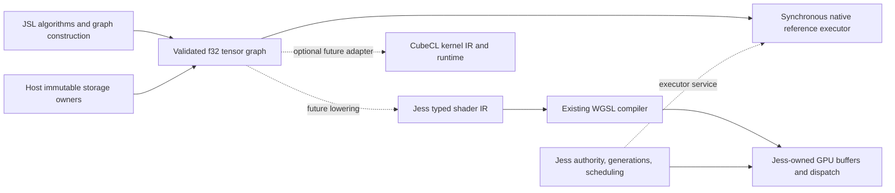

# R&D decision and integration boundary

## Result

**Defer CubeCL adoption; retain it as an optional kernel-backend candidate.** This milestone has
working CPU numerical programs authored in JSL, an implemented typed graph with persistent immutable
storage, bounded planning and execution work, failure/release tests, reproducible measurements,
and a demonstrated existing Jess shader/GPU path. It does not deliver a production compute extension,
general-rank tensor library, optimized graph compiler, or inference engine.

The key positive result is that JSL can compose numerical dataflow without compiling arbitrary
Luau bodies. The key negative result is that neither the tested CubeCL CPU bridge nor the native
reference graph interpreter justifies replacing existing `dream.data` operations. The typed graph
and storage contract can be evaluated independently of the choice of kernel compiler.

Solid edges are implemented in the isolated CPU proof or the existing Jess system. Dotted edges
are integration designs, not claimed implemented adapters. `research/fused-shader.jsl` directly uses
Jess's existing shader frontend; it is not an automatic lowering from the Rust tensor graph.

## Capability matrix at this milestone

| Requirement | Evidence / status |
| --- | --- |
| Existing source audit and contracts | `README.md`; updated sharing/lifecycle analysis below |
| CPU CubeCL kernel | Pinned 0.10.0 and 0.11.3 isolated crates; previous verified runs |
| JSL-authored CubeCL specialization | 0.10 `dynamic.rs`: JSL operations become comptime-specialized IR; tiny old operation string remains research scaffolding |
| Backend-independent typed graph | `graph-cpu/src/lib.rs`: f32 scalar/rank-two DAG, topological plan and read-only adapter boundary |
| JSL graph execution | `graph-cpu/example.jsl`: symbolic operations, broadcast, fusion and matrix multiplication; native plan interpreter, no generated machine code |
| Persistent storage and sharing | Explicit import copy; zero-copy views and plan retention; host-owner import with pointer-identity test |
| Allocation and compilation limits | Per-value/work/node/depth limits, aggregate live-node/plan limits, shared live-payload budget and recovery tests |
| Compiler artifacts | Graph plan dump; existing CubeCL IR/MLIR dump mechanism |
| Correctness and lifetime | Debug and release unit tests, JSL GC/teardown, alias/stride/empty/overflow/f32 edge tests |
| Performance | Raw release runs in `results/`; methodology in `graph-cpu/README.md`; earlier CubeCL measurements in `README.md` |
| Jess shader and resource reuse | Persistent-buffer software-GPU experiment passes; actual graph-to-shader adapter remains deferred |
| Hard LLVM failure/time/memory containment | Not provided by the 0.10 bridge; not required by the bounded non-JIT graph planner; a production CubeCL adapter still needs it |
| Production API / arbitrary Luau compilation / transformer | Intentionally not implemented |

## CubeCL feasibility: concrete interfaces, not a promise of stability

The pinned latest experiment is CubeCL **0.11.3**. Docs.rs still identifies it as latest when
rechecked for this report. The earlier 0.10.0 pin is retained only to preserve its working
specialization evidence; the graph proof has **no CubeCL dependency**. Both are isolated Cargo
workspaces, excluded from L3i's published package and default dependency graph.

CubeCL's IR can be built dynamically by a non-Rust frontend implemented in Rust. In 0.11.3,
`cubecl-runtime/src/kernel.rs` publicly exposes `CubeKernel::define() -> KernelDefinition`,
`KernelMetadata::{id,address_type}`, and `KernelDefinition { body: Scope, info: Info,
settings: KernelSettings }`. `cubecl-ir/src/scope.rs` supplies the IR scope; the compiler consumes
it through the runtime's launch path. A custom frontend must construct valid typed operations,
argument metadata, addressing, bounds, launch topology, numerical mode and a complete kernel
identity. These are substantially different concerns from tensor shape/dataflow construction.
They do **not** imply a Luau-native-IR conversion path.

No upstream patch or fork is intrinsically necessary to reach those public interfaces. They are
alpha compiler APIs, not a stable cross-language frontend protocol. The change from the 0.10
expansion machinery to 0.11's current IR is itself a reason to isolate an adapter. The existing
0.10 specialization proof reaches compiler IR through the supported macro expansion path and
proves a constrained programmable kernel; it is not a hand-built general 0.11 IR adapter.

A direct 0.11 tensor-graph adapter is therefore **feasible but not implemented**, not disproved.
It is deferred because the present CPU measurements give no adoption case, strict numerical
agreement has not been established across its targets, and storage/failure policy must precede
production integration. It would be misleading to call that an impossibility or to present the
predefined 0.11 kernel as equivalent evidence. High-level graphs already express the architectural
composition needed for future inference without this adapter.

0.11.3 also has `define_kernel` converting a Rust expansion panic into `CompilationError` and
fallible `ComputeClient::read_one`; those are useful improvements over the older bridge's unchecked
readback. They are not hard compiler timeouts or total memory quotas, and have not been exercised
as fault-injection integration tests here. The old 0.10 bridge cannot be made a production sandbox
merely by adding `catch_unwind`, especially across Luau's foreign exception boundary. A host service
must either trust a narrowly bounded kernel generator or isolate compilation/execution where hard
limits can be enforced. The reference planner avoids LLVM and its failure domain entirely.

CPU requirements: 0.11.3's dependency graph requires at least Rust 1.95 and bundles LLVM 23;
the user-approved L3i MSRV is now 1.99.1. Local rustc 1.99.1 uses LLVM 23.1.1, and Clang 23.1.2
satisfies the verified cross-language major-version rule without an override. 0.10's CPU backend
bundles a separate LLVM 20 runtime. Startup, allocation, dispatch and readback costs are recorded
separately where measurable; first launch timings combine compilation and execution and must not
be described as isolated JIT times. Licenses are MIT OR Apache-2.0 at crate level; packaging a
future backend still needs a transitive/bundled-LLVM license inventory.

For future optimized matmul, investigate CubeK's kernel routines before writing another kernel
library. CubeK is a collection of low-level kernels, while Burn supplies a model/tensor framework.
Neither is a dependency of this work. A high-level graph must retain independent shape, ownership
and numerical semantics even if a backend later selects a CubeK routine.

## Reusing Jess storage, devices and lifecycles

Jess was inspected at `28dc6bb` (`feat/immutable-worker-buffers`), in its normal checkout, with
unrelated untracked handoffs preserved. L3i remains on `feat/jsl-compute-rd`. No Jess source edit
or branch switch was needed for this milestone.

### Immutable CPU payloads

Jess `src/runtime/shared_buffer.rs` already provides a sealing builder and `SharedBuffer` with an
`Arc<Storage>`, checked ranges, immutable bytes and last-owner accounting. `seal` moves the
allocation; slices retain it. The private byte accessor is usable by a **Jess-side internal
adapter**. The graph's `Storage` owner contract is deliberately compatible: retain an existing
shared buffer and expose its stable byte interval. Do not copy it into a second long-lived tensor
allocator or add another worker-message serialization format. Existing worker transport should
continue carrying its established owner type. The graph owns only leases/views and fresh outputs.

The standalone `Vec` owner is a test adapter, not a proposal to move Jess's allocator into L3i.
A production decision about where a small immutable-owner interface lives requires a paired
review; no dependency from L3i to Jess is acceptable. Host-owned input memory remains charged to
the host; output memory is charged once at its actual allocation. Dropped views, messages and
programs release their own references. Retaining a program intentionally retains its captured
inputs; callers must release the program to release those owners.

### GPU ownership and submission

Relevant current contracts:

- `src/lua/gpu/device.rs`: `SharedDevice` belongs to the domain and retains one `Arc<Gpu>` across
  generations; `Opened` supplies it to the runtime, and runtime-owned draw sets remain separate.
- `src/gpu/live.rs`: tokens count live resources and assign process-wide identities; caches must
  use resource identity rather than recyclable addresses. Buffer wrappers in
  `src/lua/gpu/resources.rs` retain `Arc<Gpu>` and `Arc<Buffer>`.
- `src/runtime/resources.rs`: services register releases with generation ownership; teardown
  takes releases newest-first and invokes them outside the registry borrow. Do not give a graph
  service an independent lifetime that bypasses this registry.
- `src/gpu/commit.rs`: deferred changes are byte/count bounded and applied in order under the
  frame lock. Commit is whole with respect to a recorded frame, **not transactional**: later
  changes still run after a failure, and the first failure is reported.
- `src/lua/gpu/pipeline.rs::committed` and `dispatch`: script dispatch flushes pending changes
  before using the GPU. Buffer read/readLater likewise use the existing commit and pending-read
  machinery. A new backend must preserve these visibility and lifetime rules.

The preferred first GPU adapter is a **Jess-side partition lowering** into its existing validated
`shader::Program`. Keep storage buffers as existing Jess resource handles, pipeline/bind-group
creation in the existing API, and submit through ordinary dispatch. A graph plan must retain
resource leases until its last in-flight use completes. Generation teardown rejects future
submissions and releases the service's leases without invalidating buffers still used by accepted
work. This is a proposed integration contract, not a claim that generation teardown has been tested
with the new graph. It avoids a second script-facing GPU namespace and scheduler.

`fused-shader.jsl` now verifies two dispatches on Vulkan llvmpipe with the same pipeline, bind group
and buffers. It mutates a Luau source after enqueueing its upload and checks the uploaded value is
unchanged, then updates the existing GPU input, dispatches again and waits on `readLater`. No
hardware GPU is required. These finite integer-valued fixtures demonstrate resource reuse and
commit visibility, **not full strict-f32 equivalence**: the example's WGSL `max` is not assumed to
preserve NaN semantics. A strict graph adapter must prove or reject such cases explicitly.

### CubeCL/wgpu interoperability

0.11.3's `WgpuSetup` holds `wgpu::{Instance,Adapter,Device,Queue}` and backend. Public
`try_init_device` registers an existing setup without enlarging enabled capabilities. Register
once per Jess device and clone the returned runtime identity; repeated setup registration does
not deduplicate handles. Jess uses wgpu 30.0.1; CubeCL declares `^30.0.0`. This is compatible at the
version-selection level, **not a tested combined Jess/CubeCL device integration**. Jess's raw
handles are private, and capability/feature negotiation must be checked on its actual device.

CubeCL's `ComputeClient::get_resource` can export a managed backend resource and `WgpuResource`
contains its wgpu buffer. That is useful evidence, but not a proof of supported import of arbitrary
Jess-owned buffers into CubeCL's memory manager. Nor does cloning a wgpu buffer transfer its
allocator lease, account for generations, or order two schedulers. Adopting CubeCL's allocator
would risk duplicating Jess's resource ownership. Do not claim zero-copy GPU interoperability
until a narrowly scoped internal adapter proves ownership, usage/alignment, feature, queue ordering,
failure and teardown behavior with the exact resolved dependency versions.

## Smallest next production decision

1. Review the implemented immutable-owner/view and typed-plan contracts. Prefer adapting existing
   Jess shared storage over a new allocator. Decide rebindable input slots and service lifetime
   before exposing a persistent public graph API.
2. Optimize one CPU elementwise partition behind this same plan, measuring against `dream.data`
   and the Rust reference. Reuse existing native lowering when it can honor the storage and
   f32 contract; do not pretend Luau's buffer-specific IR already reads arbitrary external owners.
3. Prove one Jess-side graph-to-shader partition with existing resource handles, strict-mode
   rejection where necessary, and generation teardown tests. No new GPU namespace.
4. Only if workloads justify it, implement a pinned CubeCL adapter with explicit policy,
   canonical cache keys and a contained compiler failure boundary; compare optimized matrix work.

Transformer architecture, model loading, sampling, training, quantization and caches are outside
this R&D milestone. They belong in later JSL/application work, not in L3i's primitive layer.

## Primary upstream references

- [CubeCL 0.11.3 release metadata](https://docs.rs/crate/cubecl/0.11.3)
- [CubeCL kernel interfaces](https://docs.rs/cubecl-runtime/0.11.3/cubecl_runtime/kernel/index.html)
- [CubeCL wgpu existing-device setup](https://docs.rs/cubecl-wgpu/0.11.3/cubecl_wgpu/)
- [CubeCL source and alpha API policy](https://github.com/tracel-ai/cubecl)
- [CubeK kernel library](https://github.com/tracel-ai/cubek)

## Verification record

The graph revision was validated locally with rustc 1.99.1 / Clang 23.1.2 and no
`L3I_UNVERIFIED_TOOLCHAIN` override:

- L3i `cargo test --all-features`: 115 unit and 458 integration tests passed; one integration
  test and one doc-test intentionally ignored, no failing tests. Socket tests ran with local
  network access outside the filesystem sandbox.
- Root format check and strict all-feature/all-target pedantic Clippy passed.
- `cargo check --all-features` passed on the declared MSRV (active stable is exactly 1.99.1).
- `cargo package --allow-dirty --no-verify --offline` packaged 983 files successfully. This is
  a packaging dry run, not a separate build of the packaged archive.
- Graph locked debug **and release** tests passed: five native contract tests and one end-to-end
  JSL test that creates/destroys two runtimes. Graph format and strict pedantic Clippy passed.
- Two release benchmark processes checked every output and exited successfully. Raw reports
  are committed in `results/`; aggregate native payload returned to zero after host collection.
- Extended existing-shader test ran on Vulkan llvmpipe, **passed rather than skipped**, including
  persistent buffers, deferred-upload isolation and async readback.
- The unchanged CubeCL experiments retain the verified results recorded at `85124ca`; their
  commands remain in `verify.sh`. The new graph does not depend on either experimental backend.

No CI workflow/job was added. Before this revision was pushed, the existing PR's Linux, Windows,
Apple Silicon macOS, Intel macOS and site jobs passed at `85124ca`. Its separate existing
format/audit/MSRV/packaging job failed during LLVM installation because `apt.llvm.org` could not be
resolved, before any build. That infrastructure result is not a local test failure or a claim that
CI passed. The PR check UI is the source of truth for subsequent runs.
