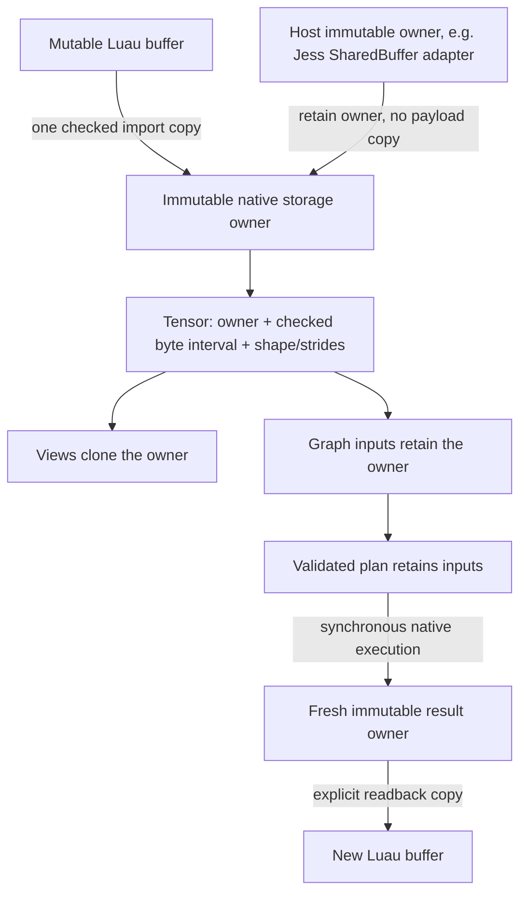

# Typed graph and immutable tensor ownership proof

This **isolated research crate** is the runnable version of the small graph contract. It is not
an L3i extension or a production accelerator. No CubeCL, Burn, Candle, Jess dependency, new syntax,
expression-string parser, default library feature or CI job is added. The old CubeCL specialization
experiment remains separate. Run from the repository root so the verified Clang/LTO configuration
applies:

```sh
cargo test --locked --manifest-path research/graph-cpu/Cargo.toml
cargo test --locked --release --manifest-path research/graph-cpu/Cargo.toml
cargo run --locked --release --manifest-path research/graph-cpu/Cargo.toml -- --bench
```

`example.jsl` is embedded in the research host, not runnable with an ordinary `jess` installation.
The host registers experimental userdata using L3i's existing module/binder machinery. The example:

```luau
local a = compute.f32(inputA, 2, 3) -- one explicit import copy
local b = compute.f32(inputB, 1, 3)
local program = a:expression():mul(b:expression())
    :add(compute.constant(2)):relu():compile()
print(program:ir())
local result = program:run() -- synchronous; retains no Lua pointer; no input copies
local bytes = result:read() -- explicit materialization into a new Luau buffer
```

## What is actually compiled

JSL builds immutable typed nodes with `Input`, scalar `Constant`, `Add`, `Mul`, `Relu`, and
`MatMul`. Compile validates the DAG, deduplicates shared nodes by identity, assigns topological
indices, checks a work bound, and publishes a read-only plan. `Executable::steps()` exposes typed
instructions and shapes for a future backend adapter. It never exposes mutable plan internals.

The CPU executor **interprets this validated plan in native Rust**. It does not generate new
machine code or call LLVM. An all-elementwise graph runs one fused outer loop with a fixed stack
register array; it creates no per-element userdata, tables, callbacks or heap allocations. A graph
containing matrix operations uses a straightforward native matrix loop and materializes intermediate
node results, retaining input owners without copying. This is a correctness reference and ownership
experiment, not a novel replacement for `dream.data` or its native lowering.

Inputs are captured immutable tensor values, not rebindable placeholders. This keeps the first
contract small; application code can build another plan using a new input. Rebinding slots without
replanning, multiple outputs, general rank, symbolic dimensions, layout specialization, liveness
planning and a native code generator are **not implemented**. The prototype has no global kernel
cache or asynchronous queue. `run` returns only after execution finishes, so no extra fence is
needed for a CPU result. Readback is explicit; there is no fake asynchronous API.

## Type and numerical contract

The type is explicitly f32: `compute.f32` imports little-endian f32 bytes without casting them.
There is no generic dtype argument; integer, f16 and f64 computation are unsupported. Each node
has either scalar shape or rank-two `[rows, columns]`. Rank-one vectors can be represented as
`[1,n]`; this is not a general-rank implementation. Dimensions, offsets and strides use L3i's
`Exact<usize>` converter: fractional, negative, nonfinite and overflowing values fail.

Broadcasting is dimensionwise equal-or-one, including `1 -> 0`. A scalar broadcasts to either
rank. Matrix multiplication requires `[m,k] @ [k,n]`; `[m,0] @ [0,n]` returns positive zeros but
**still checks the output budget**. All extents and view byte arithmetic are checked. Offset and
strides are byte counts; unaligned and zero-stride reads are supported without pointer casts.

Every add and multiply rounds to f32 separately under the platform's ordinary floating-point
rounding environment. No FMA or fast-math permission is given. Matmul starts at +0, multiplies
then adds in increasing k order. ReLU is `x <= 0 ? +0 : x`: it preserves NaN classification and
maps both signed zeros to +0. NaN payload bits are not promised. Debug and release tests cover
NaN, infinities, signed zero, a subnormal and a distinguishing non-FMA case. This evidence is for
the tested x86-64 toolchain; it does not certify arbitrary altered floating-point environments or
WGSL/CubeCL backends. Such backends must demonstrate the same mode or reject it.

`dream.data`'s existing contracts remain untouched, including f64 reductions and ordered overlap
behavior. Using those reductions to implement the strict f32 matrix reference would change its
rounding semantics; this is why the small matrix reference is separate.

## Ownership and sharing



`Storage: Send + Sync` gives a trusted host adapter an immutable byte slice tied to the owner's
lifetime. `Tensor::from_storage(Arc<dyn Storage>, ...)` imports an **existing owner**, not a borrowed
pointer. A custom external-owner test verifies allocation-address identity and last-owner release.
The adapter's byte range must be stable and immutable for its lifetime. Jess's `SharedBuffer` is a
suitable source contract; this crate does not add a parallel worker transport or shared-buffer
builder. A small `Vec<u8>` owner exists only to run this standalone host and hold CPU results.
An actual Jess adapter belongs inside Jess, where `SharedBuffer::bytes` is crate-private today.
No adapter or reverse L3i-to-Jess dependency is introduced here.

Imports call `BufferView::read` into preallocated owned storage. They never manufacture safe slices
from Luau memory or retain `BufferView`. Views retain the exact same `Arc`; no payload copy occurs.
Derived views cannot widen the parent's backing **byte interval**. A strided parent's gaps within
that interval are addressable; this is a storage-view contract, not a subset-of-logical-elements
capability. Empty views validate their offset and never dereference storage. In-place writes and
mutable aliases have no API. Graph and tensor destructors only release native owners and never
call Lua. Native ownership is independent of VM lifetime.

The tests check transposition, zero-stride broadcast, owner identity, surviving dropped wrappers,
concurrent immutable reads, last-owner release, allocation-budget recovery, JSL buffer mutation
after import, collection before retained-plan execution, and complete release across two runtime
creations. There are no retained raw addresses and no runtime-pointer registry.

## Resource policy and failure behavior

| Limit | Scope |
| --- | --- |
| 1,048,576 f32 elements and maximum dimension | Each value, including empty/zero-inner cases |
| 64 nodes and depth 64 | Each compiled graph / expression chain |
| 4,096 live expression nodes; 128 live plans | Process-wide; RAII leases, including runtime recreation |
| 67,108,864 conservative scalar-work units | Each run, established at compilation |
| 64 MiB live owned payload | Shared research host budget across VMs; last owner releases charge |

The host-supplied budget charges payload once; views and plans do not recharge aliased storage.
External owners retain their host's own accounting, avoiding double charging. Budgeted allocations
reserve fallibly; errors release reservations and partial intermediates through RAII. Exhaustion
of nodes, plans or payload is tested, followed by successful use after release. No partial result
or executable is published on error. There is no compiler worker to hang or panic in this backend:
planning is bounded by the node cap, with no exponential expansion of shared DAGs.

These are explicit operation/ownership limits, **not a hard OS process-memory or wall-time quota**.
Arc/control-block and bounded plan metadata allocations can still abort on system OOM. Readback
has a bounded temporary Vec plus a Luau-owned result governed by VM policy; those copies are not
charged as persistent native storage. Concurrent callers can consume CPU simultaneously; a Jess
service must schedule them under its existing application policy. No catch-unwind is inserted
across Luau frames. The separate CubeCL experiment still needs a stronger isolation strategy before
accepting hostile programs or imposing hard LLVM time/memory limits.

## Measurements

Raw stdout and `/usr/bin/time -v` reports: [`../results/graph-cpu-1.txt`](../results/graph-cpu-1.txt)
and [`../results/graph-cpu-2.txt`](../results/graph-cpu-2.txt). Two fresh processes, Intel i7-10870H,
x86-64 Linux, rustc 1.99.1 (LLVM 23.1.1), Clang 23.1.2, ordinary Cargo release optimization with
repository cross-language LTO flags. No concurrent Cargo build ran during measurement.

Workload: `relu(a+b+2)`, `a[i]=i%101-50`, `b[i]=i%13-6`, n in `{0,1,1024,65536}`. JSL setup is
outside timing. Warm numbers average 20 calls, not a statistical distribution. Every element is
checked against the existing three-pass `dream.data` result; native Rust also checks independent
integer reference values. Times below are microseconds, each row a separate process:

| n | Import both inputs | Graph build/compile | First run | Warm run | Readback | dream.data 3 passes | Rust preallocated |
| ---: | ---: | ---: | ---: | ---: | ---: | ---: | ---: |
| 1,024 | 5.790 | 1.553 | 12.971 | 13.416 | 3.797 | 6.764 | 0.146 |
| 65,536 | 186.014 | 4.715 | 977.435 | 913.730 | 252.691 | 426.275 | 16.055 |
| 1,024 | 2.851 | 1.657 | 13.252 | 14.883 | 3.785 | 6.753 | 0.149 |
| 65,536 | 150.618 | 2.282 | 887.370 | 929.215 | 289.404 | 422.560 | 16.750 |

All graph timings include the JSL/native crossing. Compilation is plan construction, **not JIT**;
first run includes zero-initializing and allocating fresh output. Warm runs also allocate output
and wrapper metadata, but reuse input owners with zero input payload copies and no elementwise
intermediate tensors. A counter asserts 20 payload acquisitions for 20 calls (zero-byte results
reserve logically but need no payload allocation). It does not count allocator/control-block or
VM allocations. Readback allocates a temporary Vec and a new Luau buffer; it is outside warm time.
`dream.data` and native Rust reuse output allocations. No-op plus JSL loop cost was 0.0241/0.0247 us
per call over 10,000 iterations; it is a lower-bound proxy, not an isolated ABI measurement.

Peak RSS was 16,192/16,368 KiB for the complete processes, including VM, example tests, inputs,
retained result garbage and benchmark fixtures. GC may run during warm calls and contributes to
variance; the host collects afterwards and asserts zero live owned payload. `live_before` in raw
output includes prior unreachable wrappers awaiting GC, not solely the current fixture.

The native instruction interpreter is slower than `dream.data` here despite fusion and input
sharing. Dispatching each node and general strided indexing in the scalar loop are evident costs;
this experiment does not quantify their individual share. The preallocated Rust loop shows ample
room for lowering improvements, not an achieved graph speedup. Keep `dream.data` for these existing
bulk workloads. Future work should lower this same validated plan, preserving ownership, rather
than adding another expression language or assuming persistent buffers alone provide acceleration.
